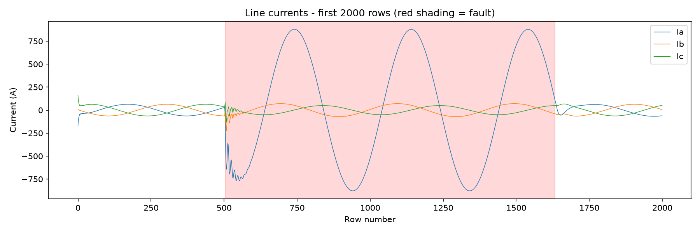
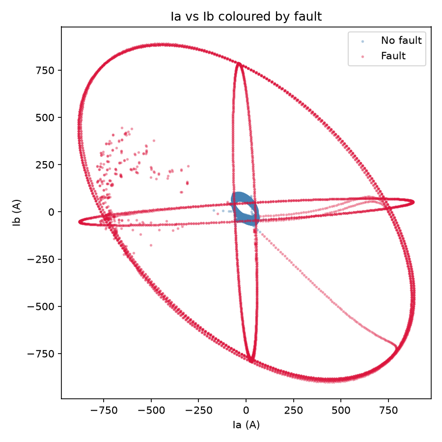
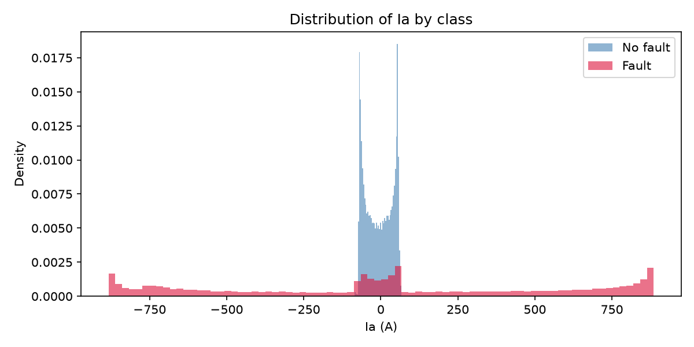
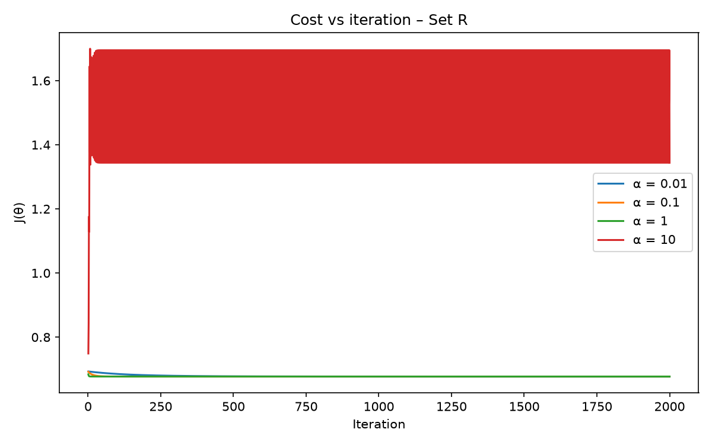
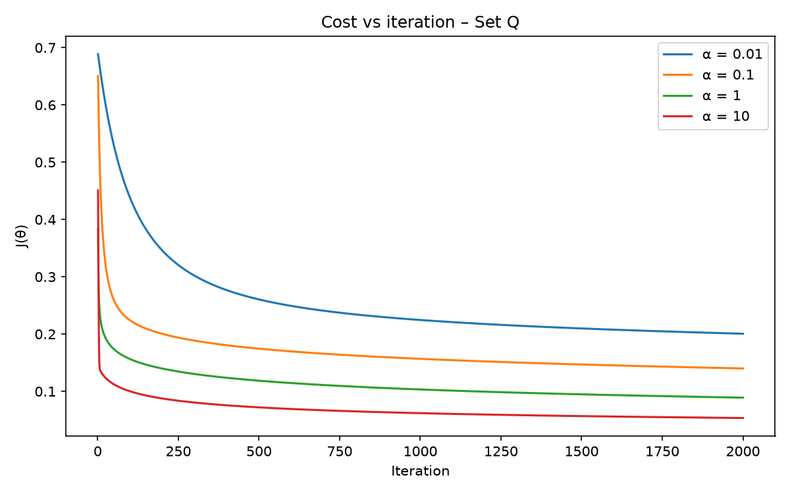
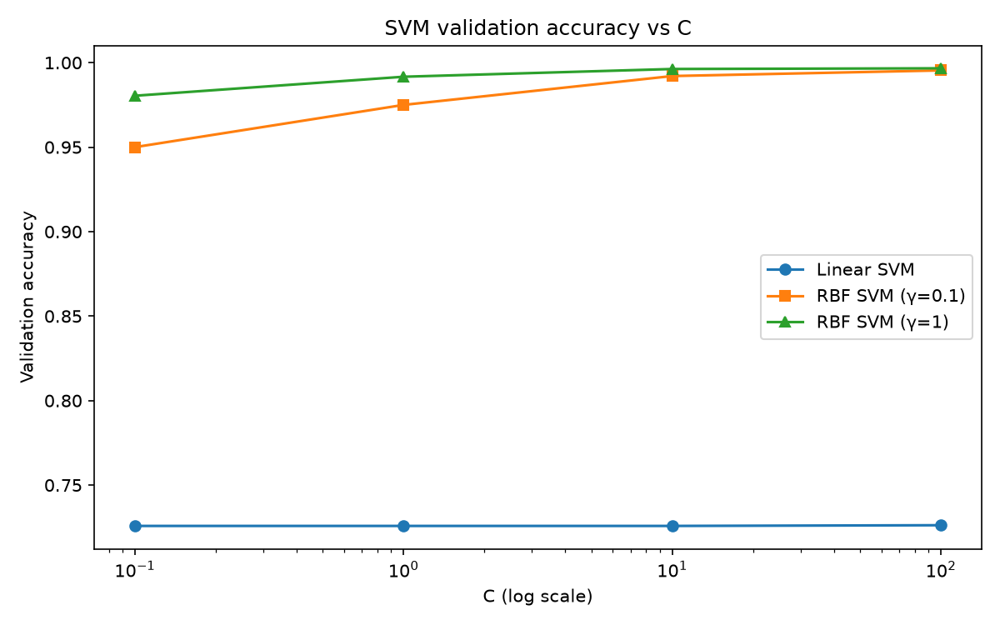
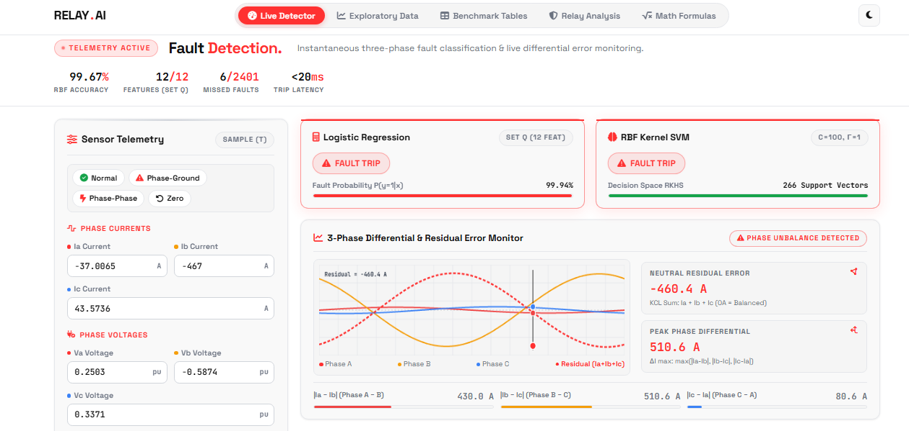

# ⚡ Detecting Faults on a Three-Phase Transmission Line

**AI4003 – Applied Machine Learning (Fall 2026) | Assignment 02**\
*A comprehensive study on transmission line protective relaying: from first-principles logistic regression by hand to Support Vector Machines (Linear & RBF kernels).*

***

## 📑 Table of Contents

1. [Problem Overview & Engineering Context](#1-problem-overview--engineering-context)
2. [Allowed vs. Forbidden Libraries](#2-allowed-vs-forbidden-libraries)
3. [Repository Layout](#3-repository-layout)
4. [Mathematical Formulation (From Scratch)](#4-mathematical-formulation-from-scratch)
5. [Exploratory Data Analysis (Task 2 Figures)](#5-exploratory-data-analysis-task-2-figures)
6. [Optimization & Hyperparameter Tuning](#6-optimization--hyperparameter-tuning)
7. [Official Assignment Tables (Tables 1 to 5)](#7-official-assignment-tables-tables-1-to-5)
8. [Task 6 – In-Depth Analysis & Viva Solutions](#8-task-6--in-depth-analysis--viva-solutions)
9. [Interactive Front-End Web Application](#9-interactive-front-end-web-application)
10. [How to Run Everything](#10-how-to-run-everything)

***

## 1. Problem Overview & Engineering Context

When an electrical fault occurs on a three-phase transmission line (such as a phase conductor contacting ground or two phases touching each other), the line impedance collapses, causing instantaneous phase currents ($I_a, I_b, I_c$) to surge to destructive levels and phase voltages ($V_a, V_b, V_c$) to sag sharply toward zero.

A high-speed protective relay must detect this condition within **milliseconds** (typically 1–2 cycles of 50/60 Hz power frequency) and send a trip command to circuit breakers to isolate the faulty section before catastrophic damage occurs.

### The Fundamental Question

> **Can a straight-line decision boundary detect a fault from raw instantaneous measurements? If not, what is the simplest fix: changing the features, or changing the classifier?**

In this assignment, we investigate this question by building:

1. **Logistic Regression completely from scratch** using pure NumPy (hypothesis, numerically stable cost function, batch gradient descent, and prediction).
2. **Support Vector Machines** using `sklearn.svm.SVC` with both Linear and RBF Gaussian kernels.
3. Two feature representations:

   * **Set R (6 raw features)**: $[I_a, I_b, I_c, V_a, V_b, V_c]$

   * **Set Q (12 quadratic features)**: $[I_a, I_b, I_c, V_a, V_b, V_c, I_a^2, I_b^2, I_c^2, V_a^2, V_b^2, V_c^2]$

***

## 2. Allowed vs. Forbidden Libraries

Strict adherence to assignment rules:

* **Allowed**: `numpy`, `pandas`, `matplotlib`, `joblib`, front-end frameworks (`flask`, `streamlit`), and from `scikit-learn` **only** `sklearn.svm.SVC`.

* **Forbidden Anywhere**: `LogisticRegression`, `train_test_split`, `StandardScaler`, `sklearn.metrics`, or any library that splits data, scales features, fits linear models, or computes metrics automatically.

All data cleaning, splitting, standardisation, logistic regression, accuracy, and confusion matrices in this repository are written entirely by hand.

***

## 3. Repository Layout

```text
AML Assign-2/
├── data/
│   └── detect_dataset.csv          # Kaggle transmission line fault dataset
├── src/
│   ├── load_data.py               # Given loader (Appendix)
│   ├── prepare.py                 # Task 1: cleaning, fixed-split, standardisation
│   ├── eda.py                     # Task 2: exploratory plots & physical analysis
│   ├── logistic.py                # Pure NumPy: sigmoid, hypothesis, cost, fit, predict
│   ├── metrics.py                 # From scratch: accuracy, confusion matrix
│   ├── train_logistic.py          # Task 3: alpha grid search, cost curves, model training
│   ├── train_svm.py               # Task 4: linear and RBF SVM grid search
│   └── test_models.py             # Task 5: single test-set evaluation
├── results/
│   ├── table1_data_prep.md        # Table 1: data prep summary
│   ├── table2_logistic.md         # Table 2: logistic regression results
│   ├── table3_svm.md              # Table 3: SVM validation grid results
│   ├── table4_test.md             # Table 4: final test results
│   ├── table5_theta_Q.md          # Table 5: learned theta weights for Set Q
│   ├── analysis.md                # Task 6: detailed analytical answers
│   ├── fig1_currents_vs_row.png   # Task 2.1: current waveforms over time
│   ├── fig2_scatter_ia_ib.png     # Task 2.2: annular ring scatter plot
│   ├── fig3_hist_ia.png           # Task 2.3: current distribution
│   ├── fig4_alpha_setR.png        # Task 3.4: cost curves (Set R)
│   ├── fig5_alpha_setQ.png        # Task 3.4: cost curves (Set Q)
│   ├── fig6_svm_accuracy_vs_C.png # Task 4: validation accuracy vs C (log scale)
│   ├── frontend_screenshot.png    # Task 7: UI preview
│   ├── theta_R.npy & theta_Q.npy  # Saved parameter vectors
│   ├── logistic_Q_model.joblib    # Saved Set-Q logistic model bundle
│   ├── best_linear_svm.joblib     # Saved best linear SVM
│   └── best_rbf_svm.joblib        # Saved best RBF SVM
├── app/
│   ├── index.html                 # Professional standalone & server web app (FontAwesome Classic)
│   ├── server.py                  # Flask backend API & static server
│   └── app.py                     # Streamlit alternative interface
├── blog_post.md                   # Full 1200+ word Medium blog post
├── linkedin_post.md               # Ready-to-publish LinkedIn post
└── README.md                      # Complete project documentation
```

***

## 4. Mathematical Formulation (From Scratch)

### 4.1 Sigmoid & Hypothesis

With feature vector $x^{(i)} \in \mathbb{R}^{d+1}$ ($x_0 = 1$ for bias) and parameter vector $\theta \in \mathbb{R}^{d+1}$:

$g(z) = \frac{1}{1 + e^{-z}}$

$h_\theta(x) = g(\theta^\top x) = \frac{1}{1 + e^{-\theta^\top x}}$

### 4.2 Cost Function with Numerical Clipping

To prevent numerical overflow when computing $\log(0)$, $h_\theta(x)$ is clipped strictly to $[10^{-12}, 1 - 10^{-12}]$:

$\ell(\theta) = \sum_{i=1}^m \left[ y^{(i)} \log h_\theta(x^{(i)}) + (1 - y^{(i)}) \log(1 - h_\theta(x^{(i)})) \right]$

$J(\theta) = -\frac{1}{m} \ell(\theta)$

At initialization where $\theta = \vec{0}$, $h_\theta(x) = 0.5$ for all $x$, so:

$J(\vec{0}) = -\log(0.5) = \log(2) \approx 0.693147$

### 4.3 Batch Gradient Descent (LMS Form)

The parameter update rule is iterated simultaneously for all $j = 0, \dots, d$:

$\theta_j := \theta_j + \frac{\alpha}{m} \sum_{i=1}^m \left( y^{(i)} - h_\theta(x^{(i)}) \right) x_j^{(i)}$

In vectorized NumPy syntax:

```python
gradient = (1.0 / m) * (X.T @ (y - h))
theta = theta + alpha * gradient
```

### 4.4 Decision Rule

$\hat{y} = \begin{cases} 1 & \text{if } h_\theta(x) \ge 0.5 \\ 0 & \text{otherwise} \end{cases}$

***

## 5. Exploratory Data Analysis (Task 2 Figures)

### Figure 1: Phase Currents vs Row Number (First 2000 Rows)



* **Physical Insight**: In normal operation, the three phase currents ($I_a, I_b, I_c$) exhibit clean, balanced sinusoidal oscillations. During fault intervals (shaded in red), current amplitudes surge dramatically to extreme peak values with severe waveform asymmetry, reflecting short-circuit dynamics.

***

### Figure 2: Scatter Plot of $I_a$ vs $I_b$ (Coloured by Fault)



* **Geometric Insight**: Normal operating points (blue) form a dense, compact cluster centered at the origin $(0, 0)$. Fault points (red) form an **annular ring (torus)** enclosing the normal cluster.

* **Why Linear Classifiers Fail**: Because AC current alternates polarity between positive and negative half-cycles, instantaneous fault values appear at both large positive and large negative extremes. Any straight line drawn through the $(I_a, I_b)$ plane slices through both classes, proving that the raw instantaneous features are **not linearly separable**.

***

### Figure 3: Histogram of Phase A Current ($I_a$)



* **Statistical Insight**: Normal currents are concentrated in a tight distribution around zero. Fault currents have heavy tails extending past $\pm 800\text{ A}$. However, because both distributions are centered near zero, a simple single threshold on $I_a$ cannot separate the classes—magnitude or squared terms ($I^2$) are essential.

***

## 6. Optimization & Hyperparameter Tuning

### Figure 4: Cost vs Iteration for Set R (4 Learning Rates)



* Learning rates $\alpha \in \{0.01, 0.1, 1.0\}$ decrease monotonically.

* $\alpha = 10.0$ overshoots and diverges ($J > 1.34$).

* **Chosen** $\alpha$ for Set R: $1.0$ (Final $J = 0.677161$).

***

### Figure 5: Cost vs Iteration for Set Q (4 Learning Rates)



* With quadratic features, the objective surface enables aggressive convergence.

* All four values decrease monotonically at every iteration.

* **Chosen** $\alpha$ for Set Q: $10.0$ (Final $J = 0.053434$, plunging from $0.693$).

***

### Figure 6: SVM Validation Accuracy vs $C$ (Log Scale)



* **Linear SVM**: Flatlines at $\sim 72.6\%$ across all $C \in [0.1, 100]$, reinforcing the non-separability barrier.

* **RBF SVM (**$\gamma = 1.0$): Reaches $99.67\%$ validation accuracy at $C = 100$, compressing support vectors from 1,347 down to 266.

***

## 7. Official Assignment Tables (Tables 1 to 5)

### Table 1 – Data Preparation & Partitioning

| Property                                    | Value                        |
| ------------------------------------------- | ---------------------------- |
| Raw rows / raw columns                      | 12,001 rows / 9 columns      |
| Columns removed (names)                     | `Unnamed: 7`, `Unnamed: 8`   |
| Missing values after cleaning               | 0                            |
| Fault rows / no-fault rows                  | 5,496 fault / 6,505 no-fault |
| Train / validation / test rows              | 7,200 / 2,400 / 2,401        |
| Fault fraction in train / validation / test | 0.4607 / 0.4512 / 0.4565     |

***

### Table 2 – Logistic Regression Optimization

| Feature set                       | Chosen $\alpha$ | Final $J(\theta)$ | Validation accuracy |
| --------------------------------- | --------------- | ----------------- | ------------------- |
| **Set R** (6 raw features)        | 1.0             | 0.677161          | 73.08%              |
| **Set Q** (12 quadratic features) | 10.0            | 0.053434          | **97.83%**          |

***

### Table 3 – SVM Validation Results (Grid Search)

| Kernel         | $C$       | $\gamma$ | Validation accuracy | Support vectors (out of 7,200) |
| -------------- | --------- | -------- | ------------------- | ------------------------------ |
| linear         | 0.1       | –        | 72.58%              | 5,849                          |
| linear         | 1.0       | –        | 72.58%              | 5,843                          |
| linear         | 10.0      | –        | 72.58%              | 5,835                          |
| linear         | 100.0     | –        | 72.62%              | 5,835                          |
| rbf            | 0.1       | 0.1      | 95.00%              | 1,347                          |
| rbf            | 0.1       | 1.0      | 98.04%              | 848                            |
| rbf            | 1.0       | 0.1      | 97.50%              | 723                            |
| rbf            | 1.0       | 1.0      | 99.17%              | 482                            |
| rbf            | 10.0      | 0.1      | 99.21%              | 381                            |
| rbf            | 10.0      | 1.0      | 99.62%              | 342                            |
| rbf            | 100.0     | 0.1      | 99.54%              | 174                            |
| **rbf (Best)** | **100.0** | **1.0**  | **99.67%**          | **266**                        |

***

### Table 4 – Final Held-Out Test Results ($N = 2,401$)

| Model                           | Accuracy   | TN (True No-Fault) | False Alarms (FP) | Missed Faults (FN) | TP (True Fault) |
| ------------------------------- | ---------- | ------------------ | ----------------- | ------------------ | --------------- |
| **Logistic Regression (Set R)** | 72.64%     | 1,305              | 0                 | **657**            | 439             |
| **Linear SVM (**$C=100$)        | 73.64%     | 1,305              | 0                 | **633**            | 463             |
| **Logistic Regression (Set Q)** | **97.88%** | 1,299              | 6                 | **45**             | 1,051           |
| **RBF SVM (**$C=100, \gamma=1$) | **99.58%** | 1,301              | 4                 | **6**              | 1,090           |

***

### Table 5 – Learned Parameters $\theta$ (Set Q Quadratic Model)

| Weight        | Feature | Value        | Physical Significance                                               |
| ------------- | ------- | ------------ | ------------------------------------------------------------------- |
| $\theta_0$    | bias    | $+24.920914$ | Global intercept                                                    |
| $\theta_1$    | $I_a$   | $+2.327292$  | Linear current component                                            |
| $\theta_2$    | $I_b$   | $-5.358084$  | Linear current component                                            |
| $\theta_3$    | $I_c$   | $-1.736503$  | Linear current component                                            |
| $\theta_4$    | $V_a$   | $-0.533569$  | Linear voltage component                                            |
| $\theta_5$    | $V_b$   | $+0.416726$  | Linear voltage component                                            |
| $\theta_6$    | $V_c$   | $+0.098580$  | Linear voltage component                                            |
| $\theta_7$    | $I_a^2$ | $+18.891238$ | **Strongly Positive**: High current energy triggers fault detection |
| $\theta_8$    | $I_b^2$ | $+4.754256$  | **Strongly Positive**: High current energy triggers fault detection |
| $\theta_9$    | $I_c^2$ | $+13.956918$ | **Strongly Positive**: High current energy triggers fault detection |
| $\theta_{10}$ | $V_a^2$ | $-6.027636$  | **Strongly Negative**: Nominal voltage confirms healthy condition   |
| $\theta_{11}$ | $V_b^2$ | $-6.464258$  | **Strongly Negative**: Nominal voltage confirms healthy condition   |
| $\theta_{12}$ | $V_c^2$ | $-6.140745$  | **Strongly Negative**: Nominal voltage confirms healthy condition   |

***

## 8. Task 6 – In-Depth Analysis & Viva Solutions

### 6.1 Why do Logistic Regression (Set R) and the Linear SVM score almost the same?

Both algorithms are **linear classifiers** operating on the exact same 6 raw standardised features. Logistic regression searches for the hyperplane maximizing log-likelihood, while Linear SVM searches for the hyperplane maximizing the margin. Because the normal points are clustered in the middle and completely surrounded by fault points in phase space (annular topology), no flat 6D hyperplane can separate them. Both algorithms converge to a boundary that essentially labels the outer extreme regions while misclassifying all fault samples that pass near zero during their AC cycle. This confirms that **the raw data is non-linearly separable**.

### 6.2 Explanation of Set Q Signs (Positive $I^2$ vs. Negative $V^2$)

During a short circuit:

* Fault impedance collapses ($Z \to 0$), driving massive current surges. Therefore, higher current magnitude squared ($I^2$) strongly indicates a fault. The positive weights on $I_a^2, I_b^2, I_c^2$ ($+18.89, +4.75, +13.96$) push $\theta^\top x$ higher, driving the sigmoid probability toward $1$ (Fault).

* Concurrently, voltage collapses (voltage sag). Healthy operation is characterized by full nominal voltage. The negative weights on $V_a^2, V_b^2, V_c^2$ ($-6.03, -6.46, -6.14$) ensure that healthy high voltage pushes $\theta^\top x$ negative, driving the probability toward $0$ (No Fault).

### 6.3 Comparing Support Vectors (Linear vs. RBF)

The best Linear SVM required **5,835 support vectors out of 7,200 training rows (81.0%)**. A vast number of support vectors indicates severe margin failure—nearly the entire dataset consists of margin violators because a hyperplane cannot separate an annular distribution. In contrast, the RBF SVM required only **266 support vectors (3.7%)**. The Gaussian kernel projects the data into an infinite-dimensional space where the classes become cleanly separable, requiring only a small set of boundary points.

### 6.4 Effect of $C$ on Accuracy and Support Vectors

$C$ controls the trade-off between margin width and violation penalty in the objective $\min \frac{1}{2}\|w\|^2 + C \sum \xi_i$:

* At small $C$ ($0.1$), the optimization permits numerous slack violations, resulting in 1,347 support vectors and $95.0\%$ validation accuracy.

* As $C$ increases to $100$, margin violations are heavily penalized, forcing the decision boundary to conform strictly around the complex boundary geometry. This drives validation accuracy up to $99.67\%$ and compresses support vectors down to **266**.

### 6.5 Temporal Correlation & Train/Test Splitting (Optimistic vs. Pessimistic)

The test accuracy is **optimistic** for a real protective relay. The dataset consists of consecutive time-series samples from a numerical simulation. A random row split causes adjacent time steps of the exact same physical fault transient (which differ only by microseconds) to land in both the training set and the test set. In a real substation, a relay encounters entirely novel fault events with unknown fault angles, impedances, and line lengths. Testing on correlated time slices yields an over-optimistic evaluation compared to real-world deployment.

### 6.6 Which Model to Deploy in a Real Protective Relay?

In protection engineering, the asymmetric cost of errors is paramount:

* **Missed Fault (False Negative)**: **Catastrophic**. The breaker fails to trip, resulting in conductor melting, substation fire, explosion, or grid collapse.

* **False Alarm (False Positive)**: **Operational nuisance**. The breaker trips unnecessarily, interrupting service temporarily without hardware destruction.

Both linear models missed over **630 faults** (unacceptable for safety).\
The **RBF SVM** missed only **6 faults** with 4 false alarms ($99.58\%$ accuracy).\
The **Set Q Logistic Regression** missed **45 faults** ($97.88\%$ accuracy) and computes in $\sim 1\,\mu\text{s}$ via a simple 13-element dot product, making it ideal for low-cost embedded DSPs.\
**Deployment Decision**: Deploy the **RBF SVM** (or an ensemble of both) to minimize missed faults.

***

## 9. Interactive Front-End Web Application

### Preview Screenshot



### Key Features of the Web Application

* **Direct Double-Click Browser Execution (`app/index.html`)**: You can simply double-click `app/index.html` to open it in Chrome, Edge, Safari, or Firefox without launching any server. The embedded client-side inference engine evaluates the models instantly in JavaScript.

* **Flask Server Backend (`app/server.py`)**: Alternatively, running `python app/server.py` serves the application locally at `http://127.0.0.1:5000` with the `/predict` API route.

* **High-Voltage Protection System Interface**: Built with an authentic electrical engineering aesthetic. Features:
  - **Space Grotesk & JetBrains Mono Typography**: Clean geometric headings with high-contrast monospace numerical readouts.
  - **Monochrome + Electric Crimson Accent (`#ff3131`)**: Premium minimalist palette with subtle crimson border glows (`rgba(255, 49, 49, 0.25)`).
  - **Floating Spotlight Pill Navbar**: Glassmorphic pill container (`backdrop-filter: blur(18px)`) with smooth tab switching and a built-in Dark/Light mode toggle.
  - **Dynamic Contextual Header**: The top section automatically transforms its titles, metrics, watermark, and badges specifically for each active tab.
  - **Live 3-Phase Differential & Residual Error Monitor**: Real-time canvas graph computing Kirchhoff residual error ($I_a + I_b + I_c$) and phase-to-phase differences ($|I_a - I_b|, |I_b - I_c|, |I_c - I_a|$) dynamically from input values.
* **Font Awesome 6.5 Classic**: High-fidelity icons for power transmission, gauges, alerts, waveforms, mathematics, and telemetry.
* **Three-Phase Standard Color Tags**: Phase A (Red `#ff3131`), Phase B (Amber `#f59e0b`), and Phase C (Blue `#3b82f6`).

* **Side-by-Side Live Detector**: Real-time comparisons of hand-crafted Logistic Regression (Set Q) and RBF SVM with dynamic probability meter.

* **Benchmark Presets**: One-click chips to load normal steady-state, single phase-to-ground faults, and phase-to-phase shorts.

* **Interactive Navigation Tabs**:

  1. *Live Detector*: Sensor telemetry form and side-by-side trip status meters.
  2. *Exploratory Data*: High-res gallery displaying all EDA waveforms, scatter plots, histograms, and convergence curves.
  3. *Benchmark Tables*: All 5 assignment tables rendered with clean data grids.
  4. *Relay Analysis (Q\&A)*: Comprehensive theoretical and engineering answers to Task 6 viva questions.
  5. *Math Formulas*: Complete mathematical formulations derived from first principles.

***

## 10. How to Run Everything

### Prerequisites

Install the required packages:

```bash
pip install numpy pandas matplotlib scikit-learn joblib flask streamlit
```

### Option A: Open Directly in Browser (Zero Setup)

Simply navigate to the `app/` folder and **double-click** **`index.html`** in your file manager. It opens immediately in any web browser with full interactive prediction capabilities.

### Option B: Run via Flask Server

```bash
python app/server.py
```

Then visit **<http://127.0.0.1:5000>** in your browser.

### Full Pipeline Reproduction

```bash
# 1. Clean, split, and standardize data (Task 1)
python src/prepare.py

# 2. Generate exploratory plots & figures (Task 2)
python src/eda.py

# 3. Train from-scratch logistic regression with alpha grid search (Task 3)
python src/train_logistic.py

# 4. Train Support Vector Machines grid search (Task 4)
python src/train_svm.py

# 5. Evaluate all models once on test set (Task 5)
python src/test_models.py
```

***

## 👥 Authors & Academic Integrity

* **Course**: AI4003 Applied Machine Learning, Fall 2026

* **Deliverables**: Code repository, Medium blog post (`blog_post.md`), LinkedIn post (`linkedin_post.md`), and interactive web dashboard (`app/server.py`).
